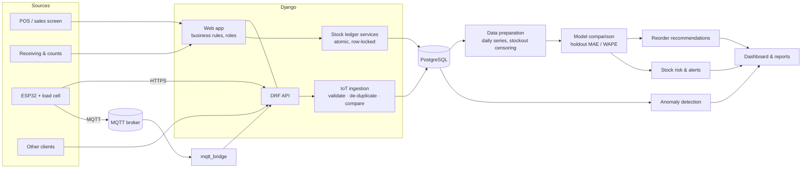

# Smart Inventory Intelligence System

An AI-, IoT- and Django-powered inventory platform for retail shops, supermarkets, wholesalers and distributors in Kigali, Rwanda. It moves inventory management from record-keeping to evidence-based decisions: it **forecasts product demand**, **anticipates stockouts and overstock**, **flags unusual stock movements**, and **recommends explainable reorder quantities** that a manager approves.

> This repository implements the project proposal *“Smart Inventory Intelligence System”* (phases 2–6: Django foundation, data preparation, ML forecasting, recommendations, IoT prototype) and provides the tooling for phase 7 (pilot evaluation).

---

## Contents

1. [Features](#features)
2. [Quick start](#quick-start)
3. [Architecture](#architecture)
4. [How the intelligence works](#how-the-intelligence-works)
5. [IoT integration](#iot-integration)
6. [REST API](#rest-api)
7. [Roles and permissions](#roles-and-permissions)
8. [Evaluation (proposal §13)](#evaluation-proposal-13)
9. [Operations and deployment](#operations-and-deployment)
10. [Project structure](#project-structure)
11. [Testing](#testing)
12. [Limitations and next steps](#limitations-and-next-steps)

---

## Features

| Module | What it does |
|---|---|
| **Products & catalogue** | Products, categories, units, SKU/barcodes, cost and selling prices, pack sizes, minimum order quantities, shelf capacity, expiry tracking. |
| **Stock ledger** | Append-only ledger of every movement (opening, receipts, sales, returns, damage, loss, expiry, count corrections) with running balances. Row-locked, atomic updates protect stock from duplicate or partial writes. |
| **Sales (POS)** | Barcode-scanner friendly point-of-sale screen, cash / mobile money / card, receipts, voids that return stock through the ledger, CSV export. |
| **Purchasing** | Draft → submitted → **manager approval** → ordered → partial / full receiving. Expiry dates and batch numbers captured at receipt. Supplier lead time, on-time rate and fill rate measured from real deliveries. |
| **Stock counts** | Count sheet for many products at once (with scanner jump). Variances post as ledger corrections; large shortages raise anomaly alerts. |
| **Batches & expiry** | First-expiry-first-out depletion, expiry alerts with an estimate of how much will not sell in time. |
| **Demand forecasting** | Six candidate models compared against a moving-average baseline on a time-based holdout; best model chosen per product; 14-day forecasts with 80% intervals. |
| **Stock risk** | Out of stock / critical / reorder now / healthy / overstock, using the inventory position (on hand + on order) versus forecast demand, lead time and review period. Updated live on every stock movement. |
| **Reorder recommendations** | Periodic-review order-up-to quantities with every calculation step shown; expiring stock excluded; one click turns selected suggestions into draft purchase orders grouped by supplier. |
| **Alerts** | Stockout risk, out of stock, overstock, expiry, unusual movements (robust z-score + Isolation Forest), sensor discrepancies and offline devices — de-duplicated, auto-resolved when the condition clears, and rateable for precision measurement. |
| **IoT** | ESP32 + load-cell firmware, HTTPS and MQTT ingestion with hashed device keys, idempotent message ids, plausibility checks and human verification before any stock change. |
| **Dashboard & reports** | KPIs, sales vs forecast chart, stock health, top products, sales report by product/category with gross margin, evaluation report. Light and dark themes. |
| **REST API** | Token-authenticated, business-scoped API for products, sales, transactions, recommendations and alerts, plus the device ingestion endpoint. |
| **Multi-business** | Every record belongs to a `Business`; users only ever see their own business. Superusers can switch between businesses. |

---

## Quick start

Requirements: **Python 3.11+** (tested on 3.13). PostgreSQL is optional for development (SQLite is used when `POSTGRES_DB` is not set).

```powershell
# Windows (PowerShell)
python -m venv .venv
.venv\Scripts\activate
pip install -r requirements.txt
copy .env.example .env            # optional
python manage.py migrate
python manage.py seed_demo        # ~1–2 min: synthetic demo shop + first forecasting run
python manage.py runserver
```

```bash
# macOS / Linux
python3 -m venv .venv && source .venv/bin/activate
pip install -r requirements.txt
cp .env.example .env
python manage.py migrate
python manage.py seed_demo
python manage.py runserver
```

Open <http://127.0.0.1:8000> and sign in:

| Username | Role | Password |
|---|---|---|
| `manager` | Owner / manager | `Demo@2026` |
| `buyer` | Purchasing officer | `Demo@2026` |
| `clerk` | Inventory clerk | `Demo@2026` |

These are **demo credentials** for the synthetic business only. For a real deployment, create an administrator with `python manage.py createsuperuser`, add the business in **System admin**, and invite staff from **Team**.

> **About the demo data.** `seed_demo` creates *Kigali Fresh Mart (DEMO · synthetic data)* with 240 days of simulated trading: weekday and payday patterns, Rwandan public holidays, supplier delays, stockouts, write-offs, monthly counts, expiring batches, an IoT scale and a few injected anomalies. It is labelled as synthetic everywhere in the UI. As the proposal notes (§12), synthetic data tests the pipeline but **cannot prove** model performance in a real Kigali shop.

---

## Architecture



| Layer | Technology |
|---|---|
| UI | Django templates, Bootstrap 5, Bootstrap Icons, Chart.js 4 |
| Backend | Django 5.2 (business rules, auth, permissions, workflows) |
| API | Django REST Framework (session, token and device-key authentication) |
| Database | PostgreSQL in production, SQLite for development |
| Analytics / ML | pandas, NumPy, scikit-learn (optional XGBoost) |
| IoT | ESP32 + HX711 load cell; HTTPS or MQTT (paho-mqtt bridge) |

### Data model

`Business`, `User`, `Category`, `Supplier`, `Product`, `InventoryTransaction` (ledger), `StockBatch`, `StockCount`, `Sale`, `SaleItem`, `PurchaseOrder`, `PurchaseItem`, `IoTDevice`, `IoTReading`, `ForecastRun`, `ModelEvaluation`, `DemandPrediction`, `ReorderRecommendation`, `Alert`.

Integrity is enforced in the database as well as in code: unique SKU and barcode per business, non-zero ledger quantities, positive sale and order quantities, non-negative batch balances, one reading per device message id.

---

## How the intelligence works

### 1. Data preparation — `apps/intelligence/services/data.py`

* Daily units sold per product, **including zero-sales days**.
* Daily closing stock is rebuilt from the ledger. A day that opened or closed at zero is **censored**: recorded sales understate true demand, so it is excluded from both training and scoring (proposal §6, “important data requirement”).

### 2. Candidate models — `apps/intelligence/ml/forecasters.py`

| Model | Notes |
|---|---|
| Moving average (28 d) | **Baseline** |
| Moving average (7 d) | Reacts faster to recent change |
| Seasonal weekday average | Captures weekly shopping patterns |
| Linear regression (ridge) | Calendar features + recent demand level |
| Random forest | Same features, non-linear |
| Gradient boosting | Uses XGBoost when installed, otherwise scikit-learn’s HistGradientBoosting |

Features are known in advance for any future date: weekday, payday window (25th–5th), Rwandan public holidays (incl. Umuganura) and the day before them, seasonality, trend, and the recent demand level at the forecast origin.

### 3. Evaluation and selection — `apps/intelligence/ml/evaluation.py`

* **Time-based holdout**: train on everything before the last 28 days, forecast those 28 days in one shot, score only on in-stock days. No future data leaks into training.
* Metrics: **MAE** and **WAPE** (Σ|A−F| ÷ ΣA), plus bias.
* The lowest-WAPE model is chosen **per product** (ties go to the simpler model), refitted on all history, and used for a 14-day forecast with an 80% interval from its holdout errors.
* Portfolio-level results for every model are stored, so you can see whether advanced models actually beat the baseline (a complex algorithm is not automatically better).

On the synthetic demo the per-product selection reduces holdout WAPE from 25.1% (baseline) to 21.6%.

### 4. Stock risk — `Product.compute_risk`

Uses the **inventory position** = on hand + on order, divided by forecast daily demand:

* **Critical** — position covers less than the supplier lead time.
* **Reorder now** — covers less than lead time + review period.
* **Overstock** — on-hand stock covers more than the business’s overstock threshold (default 60 days).

### 5. Reorder recommendations — `apps/intelligence/services/recommendations.py`

Periodic-review, order-up-to policy, exactly as in proposal §10:

```
expected demand = forecast/day × (lead time + review period)
safety stock    = configured, or z × σ(forecast error) × √(lead time + review period)
order quantity  = expected demand + safety stock − usable stock − on order
```

then minimum order quantity, pack-size rounding and shelf capacity are applied. *Usable stock* excludes units expected to expire unsold (FEFO sell-through at the forecast rate). The proposal’s worked example (30 on hand, 8/day, 3-day lead time, 7-day review, safety stock 10 → **60 units**) is a unit test. Every recommendation stores its inputs and shows each step under **Why?**, and nothing is ordered until a manager approves a purchase order.

### 6. Anomaly detection — `apps/intelligence/services/anomalies.py`

* **Immediate screening** of every manual write-off (adjustment, damage, loss, expiry): robust z-score against the product’s own history (median/MAD, |z| > 3.5), size relative to normal daily sales, and share of stock.
* **Stock-count variances** above 10% (or two days of sales).
* **Isolation Forest** over recent movements (quantity, ratio to demand, time of day, weekday, type).
* **Sales spikes** far above the product’s normal daily volume (possible data-entry errors or bulk orders).

Anomalies are flags for review, never automatic corrections.

---

## IoT integration

Data flow (proposal §7): device → HTTPS or MQTT → validation → stored reading → comparison with ledger → alert → **staff verification** → count correction.

* **Register** a device under **IoT devices**. A key is generated and shown **once**; only its SHA-256 hash is stored.
* **Calibrate**: unit weight (g per stock unit), tare (empty bin) and tolerance (%).
* **Readings outside tolerance** raise a *sensor discrepancy* alert. A later matching reading resolves it automatically. Staff can **Verify & correct** (posts an auditable count correction) or **Dismiss** (recorded as a false alarm for precision statistics).
* **Duplicate deliveries** (same `message_id`) are acknowledged but stored once, so devices can retry safely on unreliable networks. Timestamps more than 10 minutes in the future or older than 7 days are rejected.
* **Offline detection**: no reading for 3× the expected interval raises a *device offline* alert.

**Firmware**: [`iot/firmware/esp32_load_cell/esp32_load_cell.ino`](iot/firmware/esp32_load_cell/esp32_load_cell.ino) — HX711 averaging, NTP time, RAM retry queue, HTTPS (with server certificate validation) or MQTT over TLS.

**No hardware?** Use the simulator:

```bash
python iot/simulator.py --device sugar-scale-01 --key sisd_xxx --grams 133500
python iot/simulator.py --device sugar-scale-01 --key sisd_xxx --grams 133500 --every 10 --drift -1000
python iot/simulator.py --device sugar-scale-01 --key sisd_xxx --grams 133500 --repeat-last   # duplicate handling
```

`seed_demo` prints the demo device id and key.

**MQTT**: run a broker (e.g. Mosquitto), set the `MQTT_*` variables, and start `python manage.py mqtt_bridge`. Devices publish to `sis/<device_id>/readings` (QoS 1) with the JSON body plus `"key"`; acknowledgements are published to `sis/<device_id>/ack`.

---

## REST API

Base URL `/api/v1/` (browsable in development). Authenticate with a session or a token:

```bash
curl -X POST http://127.0.0.1:8000/api/v1/auth/token/ -d "username=clerk&password=Demo@2026"
curl -H "Authorization: Token <token>" http://127.0.0.1:8000/api/v1/products/?risk=critical
```

| Endpoint | Methods | Notes |
|---|---|---|
| `products/` | GET, POST, PATCH, DELETE | `?risk=`, `?barcode=`; DELETE archives; `products/{id}/forecast/` |
| `categories/`, `suppliers/` | CRUD | writes need manager or purchasing role |
| `sales/` | GET, POST | POST `{"lines": [{"product": 1, "quantity": "2"}], "payment_method": "momo"}` |
| `transactions/` | GET | stock ledger, `?product=` |
| `recommendations/` | GET | `?status=pending` |
| `alerts/` | GET, PATCH | update `status` / `feedback` |
| `dashboard/summary/` | GET | KPIs |
| `iot/readings/` | POST | device-key authentication: headers `X-Device-Id` and `Authorization: Device <key>` |

All data is scoped to the caller’s business; requests for another business’s records return 404.

---

## Roles and permissions

| Capability | Clerk | Purchasing | Manager / Admin |
|---|:-:|:-:|:-:|
| Record sales, receive goods, adjust stock, count stock | ✓ | receive only | ✓ |
| Edit products, categories, suppliers | | ✓ | ✓ |
| Create / submit purchase orders, act on recommendations | | ✓ | ✓ |
| **Approve purchase orders**, void sales | | | ✓ |
| Run forecasting manually | | ✓ | ✓ |
| Manage team, business settings, IoT devices | | | ✓ |

---

## Evaluation (proposal §13)

The **Evaluation** page reports, for the current business:

1. **Forecast error** — holdout MAE/WAPE for each model vs the baseline, and **realised** WAPE: stored forecasts compared with sales that actually happened afterwards (the honest live measure).
2. **Alert quality** — precision per alert type from staff feedback (“correct / useful” vs “false alarm”), and **stockout recall**: for every time a product’s stock reached zero, was a stockout-risk alert raised in the preceding 14 days, and how many days ahead?
3. **Stock-record accuracy** — share of physical counts within ±2% of the system figure.

Response times can be read from the server logs; transaction-recording time and user feedback should be collected during the pilot.

---

## Operations and deployment

**Daily intelligence cycle** (forecast → recommendations → alerts → anomalies → device health). Schedule once a day, e.g. 05:00:

```powershell
# Windows Task Scheduler
schtasks /Create /SC DAILY /ST 05:00 /TN "SIS intelligence" /TR "\"C:\path\.venv\Scripts\python.exe\" \"C:\path\manage.py\" run_intelligence"
```
```bash
# cron
0 5 * * * cd /srv/sis && .venv/bin/python manage.py run_intelligence >> logs/intelligence.log 2>&1
```

**Production checklist**

* `DJANGO_DEBUG=False`, a long random `DJANGO_SECRET_KEY`, `DJANGO_ALLOWED_HOSTS` and `DJANGO_CSRF_TRUSTED_ORIGINS` set (HTTPS, HSTS and secure cookies switch on automatically).
* PostgreSQL via `POSTGRES_*`, with daily backups (`pg_dump`).
* `python manage.py collectstatic`, then serve with gunicorn/uvicorn (Linux) or waitress (Windows) behind Nginx/IIS with TLS.
* MQTT broker with TLS and per-device credentials if MQTT is used; run `mqtt_bridge` as a service.
* Run `python manage.py check --deploy`.

---

## Project structure

```
config/                 settings, URLs, WSGI/ASGI
apps/
  accounts/             Business, User, roles, business scoping middleware
  inventory/            products, suppliers, ledger services, batches, counts
  sales/                sales, POS, voids, sales report
  purchasing/           purchase orders, approval, receiving, supplier performance
  intelligence/
    ml/                 framework-free forecasters, metrics, anomaly primitives, calendar
    services/           data prep, forecasting pipeline, recommendations, alerts, anomalies, evaluation
    management/commands run_intelligence, seed_demo
  iot/                  devices, readings, ingestion services, mqtt_bridge command
  api/                  DRF serializers, viewsets, device authentication
  dashboard/            dashboard, KPIs, template filters
  common/               shared abstract models, mixins, form helpers
templates/              HTML templates
static/                 CSS design tokens (light/dark), chart helpers, UI scripts
iot/                    ESP32 firmware and device simulator
tests/                  automated tests
```

---

## Testing

```bash
python manage.py test tests
```

44 tests cover the stock ledger (atomicity, negative-stock protection, count corrections, reconciliation), sales and voids, the purchasing workflow (manager approval, partial receipts, over-receipt, expiry capture), the reorder formula (including the proposal’s worked example, packs, MOQ, shelf capacity and expiring stock), forecasting (no holdout leakage, stockout censoring, all candidate models), anomaly detection, IoT ingestion (hashed keys, idempotency, validation, no automatic stock changes), API business isolation and role restrictions, and a render check of every screen.

---

## Limitations and next steps

* **Model performance must be established on real data.** Run the discovery phase, obtain permission to use a pilot shop’s records, document every field, and compare models on that shop’s history.
* Promotions and price changes are not yet model features; add them once the pilot business records them.
* Moveable Rwandan holidays (Easter, Eid) must be added per year to `EXTRA_HOLIDAYS` in `apps/intelligence/ml/calendar.py`.
* Forecasting runs synchronously when triggered from the UI (seconds for a small shop); for large catalogues, use the scheduled command or a task queue.
* Optional: GeoDjango/PostGIS for multi-branch and supplier mapping (proposal §8).
